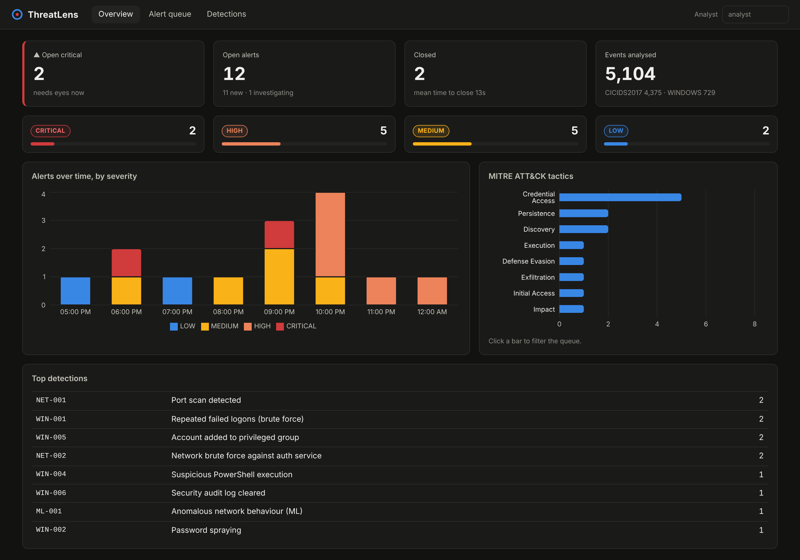
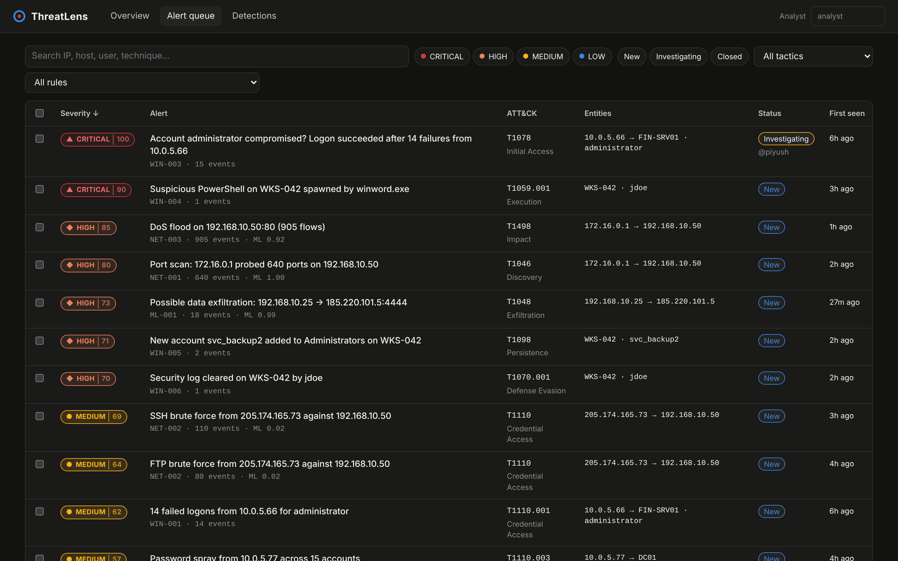
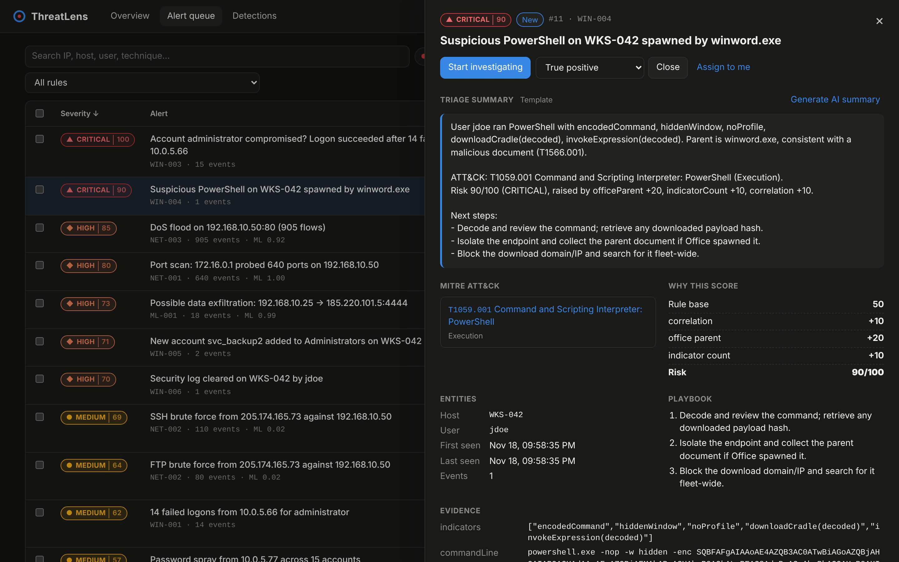
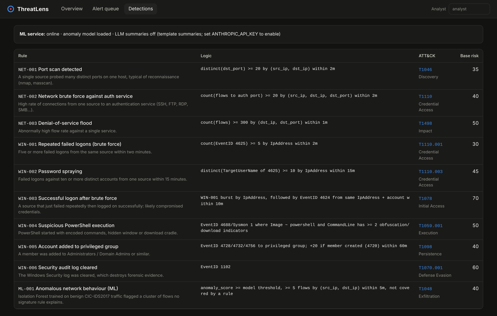
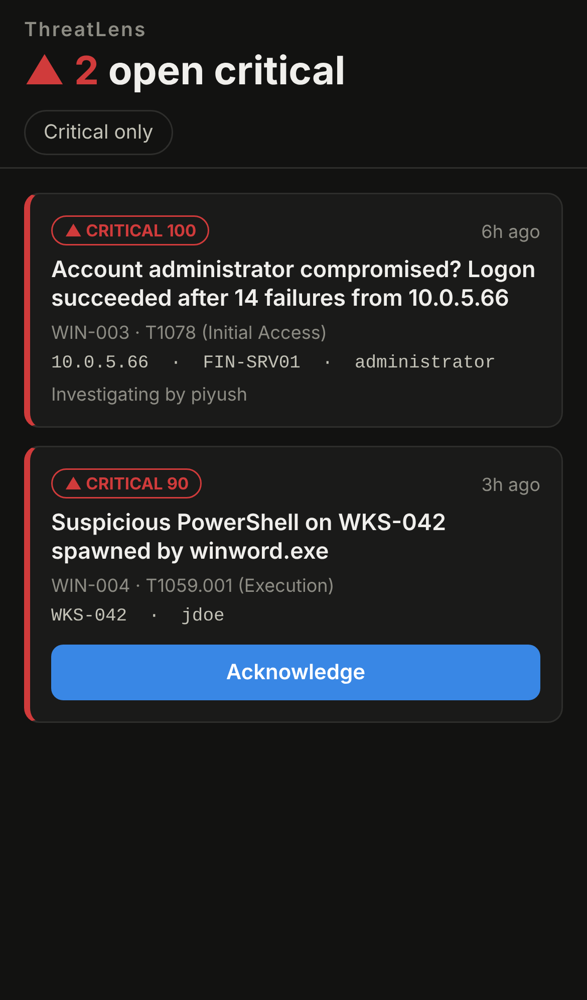
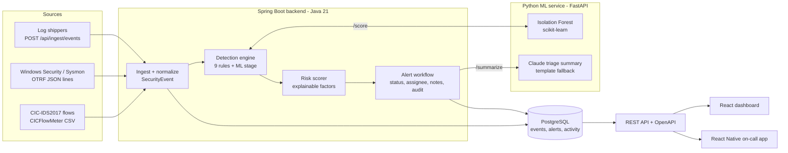

# ThreatLens: Security Alert Triage Platform

ThreatLens is a small managed detection and response (MDR) stack. It ingests network flows and Windows
security logs from public datasets, runs detection rules mapped to **MITRE ATT&CK**, scores every alert
with an **explainable** risk model, adds an **ML anomaly detector** and **LLM triage summaries**, and
gives analysts a **React dashboard** and a **React Native on-call screen** to work the queue from
`NEW → INVESTIGATING → CLOSED`.



| | |
|---|---|
|  |  |
| **Alert queue** with severity, status, tactic and rule filters, search, sorting and bulk actions | **Triage drawer** with the summary, ATT&CK link, score breakdown, playbook, raw evidence and audit trail |
|  |  |
| **Detection catalog**: every rule's logic, technique and base risk | **Mobile**: open critical alerts, one-tap acknowledge |

---

## Quick start

```bash
docker compose up --build        # postgres, ml-service, backend, frontend, then a one-shot seeder
open http://localhost:3000       # dashboard
open http://localhost:8080/swagger-ui/index.html   # REST API docs
```

The `seed` container loads the bundled CIC-IDS2017 and Windows samples. It shifts their timestamps so
the newest event is a few minutes old, which keeps the dashboard timelines readable. Within about 30
seconds you get 14 alerts across all four severities.

To turn on LLM summaries, set an Anthropic API key. Without one, ThreatLens writes deterministic
template summaries, so nothing breaks.

```bash
ANTHROPIC_API_KEY=sk-ant-... docker compose up --build
```

<details>
<summary>Run without Docker (for development)</summary>

```bash
# 1. PostgreSQL 16 with db/user/password = threatlens
# 2. ML service
cd ml-service && pip install -r requirements.txt
python -m threatlens_ml.train            # trains the Isolation Forest, prints metrics
uvicorn threatlens_ml.app:app --port 8000
# 3. Backend (Java 21)
cd backend && mvn spring-boot:run
# 4. Dashboard
cd frontend && npm install && npm run dev   # http://localhost:5173, proxies /api to :8080
# 5. Data
./scripts/seed.sh
# 6. Mobile (optional, Expo)
cd mobile && npm install && EXPO_PUBLIC_API_URL=http://<your-LAN-IP>:8080 npx expo start
```
</details>

---

## Architecture



**Request flow for one batch.**
1. An upload is parsed and normalized into `security_event` rows. Network flows and Windows events
   share one schema: `src_ip`, `dst_ip`, `host`, `user`, `process`, `command_line`, and a JSONB `attributes` column.
2. The detection engine reloads events for the batch's time range, plus each rule's look-back window,
   and runs every rule as a pure function over the time-ordered events.
3. All flows in the range go to the ML service. Its scores enrich the rule hits, and anomalous flows
   that no rule explains become `ML-001` alerts.
4. Each hit gets a **fingerprint** made of `rule | entity | burst start`. Re-running detection is
   therefore idempotent and never creates duplicates.
5. The risk scorer adds context: critical asset, ML agreement, and correlation with other rules on the
   same entity. It stores each factor so the analyst can see *why* an alert is critical.
6. HIGH and CRITICAL alerts get an LLM summary in the background after the transaction commits.

---

## Detection rules

| ID | Rule | Logic | ATT&CK |
|---|---|---|---|
| NET-001 | Port scan | `distinct(dst_port) >= 20` by (src, dst) in 2 min | [T1046](https://attack.mitre.org/techniques/T1046/) Discovery |
| NET-002 | Network brute force | `count >= 20` flows to SSH/FTP/RDP/SMB/... by (src, dst, port) in 2 min | [T1110](https://attack.mitre.org/techniques/T1110/) Credential Access |
| NET-003 | DoS flood | `count >= 300` flows by (dst, port) in 1 min | [T1498](https://attack.mitre.org/techniques/T1498/) Impact |
| WIN-001 | Failed-logon brute force | `count(4625) >= 5` by IpAddress in 2 min | [T1110.001](https://attack.mitre.org/techniques/T1110/001/) |
| WIN-002 | Password spraying | `distinct(TargetUserName of 4625) >= 10` by IpAddress in 15 min | [T1110.003](https://attack.mitre.org/techniques/T1110/003/) |
| WIN-003 | Logon succeeded after brute force | WIN-001 burst followed by 4624 for an attempted account within 10 min | [T1078](https://attack.mitre.org/techniques/T1078/) Initial Access |
| WIN-004 | Suspicious PowerShell | 4688 / Sysmon 1 with >= 2 of: `-enc`, hidden window, `-nop`, bypass, download cradle, IEX. Base64 is decoded and checked too | [T1059.001](https://attack.mitre.org/techniques/T1059/001/) Execution |
| WIN-005 | Added to privileged group | 4728/4732/4756 to Administrators, Domain Admins, ...; +20 if the account was created within 60 min | [T1098](https://attack.mitre.org/techniques/T1098/) Persistence |
| WIN-006 | Security log cleared | EventID 1102 | [T1070.001](https://attack.mitre.org/techniques/T1070/001/) Defense Evasion |
| ML-001 | Anomalous network behaviour | Isolation Forest outliers, >= 5 flows by (src, dst) in 5 min, **not already explained by a rule** | [T1048](https://attack.mitre.org/techniques/T1048/) Exfiltration / T1071 |

**Burst grouping instead of one alert per window.** A naive sliding window fires once per overlapping
window, so a 30-second brute force would raise dozens of alerts. `Windows.bursts()` starts an incident
when the threshold is reached and keeps extending it while events stay within the window. One attack
becomes one alert with all of its evidence attached (`detection/Windows.java`).

### Explainable risk scoring

```
risk = rule base score
     + rule factors      e.g. Office parent process +20, privileged account +10, fresh account +20
     + volume            up to +5, log-scaled event count
     + criticalAsset     +10 if DC01 / FIN-SRV01 / the web server is involved (configurable)
     + mlAnomaly         +5 / +10 when the anomaly model agrees
     + correlation       +10 if a different rule fired on the same IP, host or user within 24h
→ clamp 0..100 → LOW < 45 ≤ MEDIUM < 70 ≤ HIGH < 90 ≤ CRITICAL
```

On the sample data this produces a realistic queue: two CRITICAL alerts (a brute force that then
succeeded, and Word spawning encoded PowerShell), five HIGH, five MEDIUM and two LOW. The two LOW
alerts are a user locked out after mistyping a password and a helpdesk RDP grant.

---

## Machine learning

`ml-service/threatlens_ml` trains an **Isolation Forest only on benign flows** (novelty detection), using
17 CICFlowMeter features plus 3 engineered ones: forward/backward byte ratio, uncommon port, and high
port. Heavy-tailed counters are log-scaled and a `RobustScaler` is applied. The threshold is the 98th
percentile of benign scores, so the flow-level false-positive budget is 2%. Requiring 5 or more
anomalous flows per (src, dst) before raising `ML-001` brings the false-positive rate per alert much lower.

Evaluation on the bundled sample. The model trains on 70% of the benign flows and is tested on the
held-out 30% plus every attack flow. Labels are never used for training.

| Metric | Value |
|---|---|
| ROC-AUC | **0.976** |
| Precision / recall at threshold | 0.988 / 0.890 |
| Benign flows flagged | 2.4% |
| PortScan / DDoS / Infiltration flagged | 100% / 99.7% / 100% |
| SSH-Patator / FTP-Patator flagged | 0% |

The last row explains why ThreatLens uses **rules and ML together**. Brute-force flows look like normal
logins one at a time, so the model misses them while the rate rule catches them. The exfiltration
scenario (large uploads to a rare port) matches no signature, and only the model catches it.

The figures come from the sample, which is synthetic but shaped like the real data. Re-run
`python -m threatlens_ml.train --csv <real CIC file>` on the real dataset for numbers you can quote.

### LLM triage summaries

`summarizer.py` sends the alert's evidence, score factors, ATT&CK mapping and playbook to Claude (the
default model is `claude-opus-5-5`, set with `LLM_MODEL`). The system prompt asks for a fixed four-part
SOC note: *what happened, why it matters, likely false-positive causes, next steps*. It tells the model
not to invent entities. Requests use server-side refusal fallbacks. Any failure, including a missing
key, a network error or a refusal, falls back to the deterministic template, so the LLM never blocks triage.

---

## Datasets

| Dataset | Format ThreatLens parses | In this repo |
|---|---|---|
| [CIC-IDS2017](https://www.unb.ca/cic/datasets/ids-2017.html) (Canadian Institute for Cybersecurity) | `GeneratedLabelledFlows` / TrafficLabelling CSVs, including their quirks: header names with leading spaces, `Infinity`/`NaN` values, mixed timestamp formats | `data/sample/cicids2017_sample.csv`: 4,375 flows in the exact CICFlowMeter schema |
| [OTRF Security-Datasets](https://github.com/OTRF/Security-Datasets) (Mordor) | Windows Security + Sysmon events as JSON lines or a JSON array (4624, 4625, 4688, 4720, 4728/4732/4756, 1102, Sysmon 1) | `data/sample/windows_security_sample.jsonl`: 729 events |

The full datasets are several GB, so the repo ships small samples made by `data/generate_sample.py`.
The script uses each dataset's real schema and reproduces the attack scenarios in it: PortScan, DDoS
and SSH/FTP-Patator from the CIC attacker IPs, plus brute force, spraying, malicious-document
PowerShell, account manipulation and log clearing on Windows. Benign noise is included, as is one
exfiltration scenario that no rule covers.

To use the real data, run:

```bash
./data/download_datasets.sh cicids   # Friday PortScan + DDoS CSVs, first 50k rows each (CIC_MAX_ROWS)
./data/download_datasets.sh otrf     # any OTRF zip; override OTRF_URL to pick a scenario
```

Mirror URLs change over time, so both can be overridden with environment variables. Each dataset's
ground-truth label is stored on every event (`label`), but **rules never read it**. It appears in the
evidence table so you can check each detection against the truth.

---

## API (selected)

Full OpenAPI docs are at `/swagger-ui/index.html`.

| Method | Path | |
|---|---|---|
| `POST` | `/api/ingest/cicids?rebaseTime=&maxRows=` | multipart CIC-IDS2017 CSV |
| `POST` | `/api/ingest/windows?rebaseTime=&maxRows=` | multipart Windows JSON lines |
| `POST` | `/api/ingest/events` | JSON array of normalized events |
| `GET` | `/api/alerts?status=&severity=&tactic=&ruleId=&q=&sort=&dir=&page=` | filtered, paged queue |
| `GET` | `/api/alerts/{id}` | detail with evidence events, playbook and activity |
| `PATCH` | `/api/alerts/{id}/status` | `{status, resolution, note, actor}`; transitions are enforced and closing requires a resolution |
| `PATCH` | `/api/alerts/{id}/assignee` · `POST /notes` · `POST /summary` | assign, add a note, (re)generate the AI summary |
| `POST` | `/api/alerts/bulk/status` | bulk triage |
| `POST` | `/api/detections/run` | re-run every rule (idempotent) |
| `GET` | `/api/stats/overview` · `/api/rules` · `/api/ml/health` | dashboard data |

If `INGEST_API_KEY` is set, ingestion requires the `X-API-Key` header. The comparison runs in constant time.

---

## Project layout

```
backend/      Spring Boot 3.5, Java 21, JPA + Flyway, PostgreSQL
  detection/  rule interface, burst windows, 9 rules, ML rule, engine, risk scorer
  ingest/     CIC-IDS2017 + Windows/OTRF parsers, ingest service
  alert/      workflow, audit trail, playbooks, summaries
ml-service/   FastAPI + scikit-learn Isolation Forest + Anthropic SDK
frontend/     React 18 + TypeScript + Vite + Recharts (light and dark themes)
mobile/       Expo / React Native on-call screen
data/         sample datasets, generator, real-dataset downloader
scripts/      seeding helpers
```

## Tests and CI

```bash
cd backend && mvn test             # 24 tests: rules, burst windows, scoring, parsers, workflow
cd ml-service && python -m pytest  # features, model separation, API, template fallback
cd frontend && npm run build       # strict TypeScript
cd mobile && npm run typecheck
```

GitHub Actions (`.github/workflows/ci.yml`) runs all four and builds the Docker images on every PR.

## Possible extensions

- Stream ingestion (Kafka) with per-key windows held in state, replacing the batch re-scan
- Sigma rule import, so detections can be written in the community format
- Per-tenant data isolation and SSO/RBAC for a multi-customer MDR setting
- Analyst feedback (closed as false positive) fed back into thresholds and the ML training set

## License

MIT
